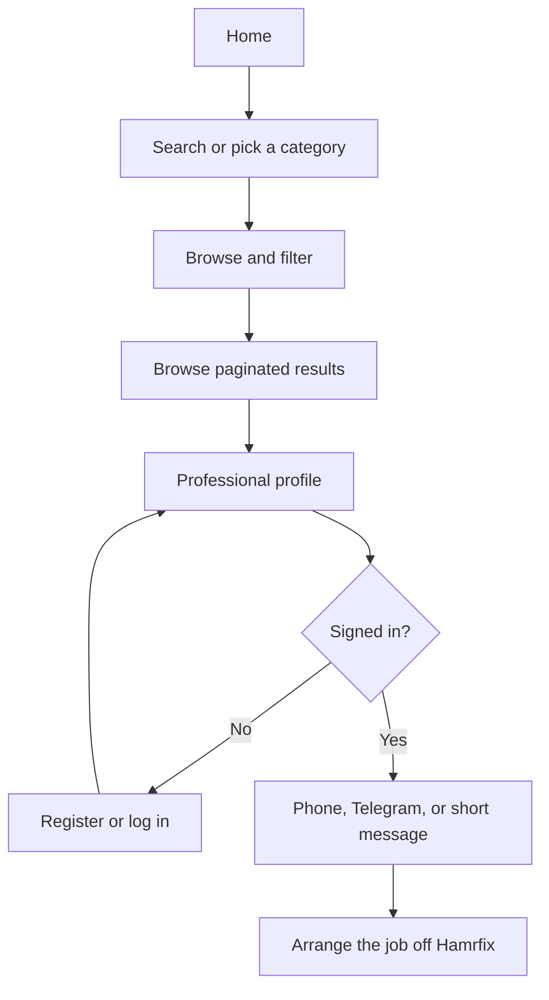
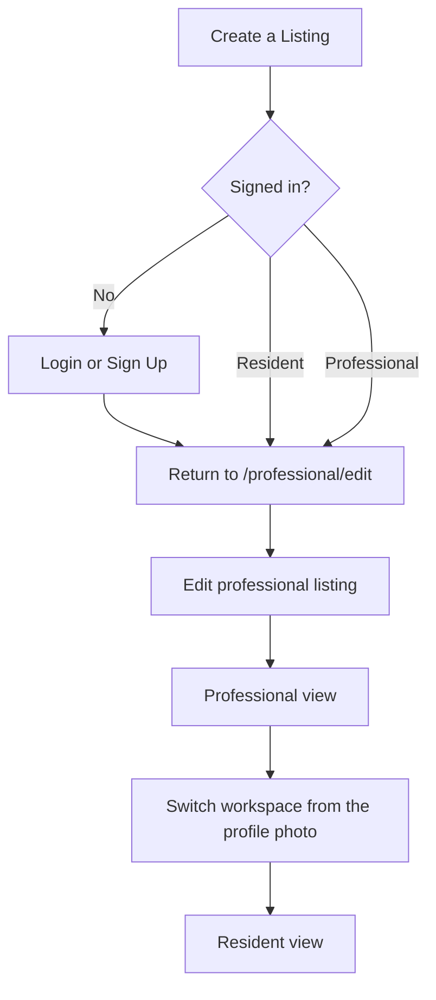

# User flows

## Find and contact

## One account, two views

Guests preserve `/professional/edit` through the `next` query parameter. Switching views does not log the person out.

## Contact gate

Guests can browse listings. Phone, Telegram, and the contact form require an account.
